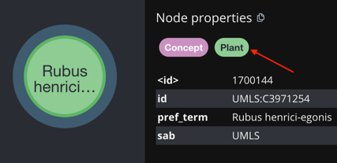

# UBKG-JKG: Example Cypher queries

Following are examples of Cypher queries to execute
against an instance of the UBKG-JKG in neo4j. 

Queries use the SAB **UBERON**.

# Specific edge from a SAB
## source
```
subject	        predicate	object
UBERON:0013152	located_in	UBERON:0002094
```
## query
```azure
MATCH (t1:Term)
    <-[r1:CODE{codeid:'UBERON:0013152',tty:'PT'}]
    -(c1:Concept)
    -[r12:located_in]
    ->(c2:Concept)
    -[r2:CODE{codeid:'UBERON:0002094',tty:'PT'}]
    ->(t2:Term) 
RETURN r1.codeid AS subject,
    type(r12) as predicate,
    r2.codeid AS object
```
## excerpt
```azure
[
  {
    "subject": "UBERON:0013152",
    "predicate": "located_in",
    "object": "UBERON:0002094"
  }
]
```

# All sources in the JKG
## query
```azure
MATCH (s:Source) 
RETURN s.sab, 
    s.id, 
    s.name,
    s.source_version,
    s.srl, 
    s.ttyl ORDER BY s.sab
```

## excerpt
```azure
[
  {
    "s.sab": "AIR",
    "s.id": "UMLS:AIR93",
    "s.name": "AI/RHEUM, 1993",
    "s.source_version": "1993",
    "s.srl": "0",
    "s.ttyl": []
  },
  {
    "s.sab": "ALT",
    "s.id": "UMLS:ALT2009",
    "s.name": "Alternative Billing Concepts, 2009",
    "s.source_version": "2009",
    "s.srl": "3",
    "s.ttyl": [
      "AB",
      "HT",
      "PT"
    ]
  }...
]
```
# All nodes imported from a SAB
## query
```azure
MATCH (t:Term)
    <-[r:CODE{sab:'UBERON'}]
    -(c:Concept) 
RETURN DISTINCT r.codeid 
    LIMIT 10
```
# All edges imported from a SAB
## query
```azure
MATCH 
    (t1:Term)
        <-[r1:CODE{sab:'UBERON'}]
        -(c1:Concept)-[r12 {sab:'UBERON'}]
        ->(c2:Concept)
        -[r2:CODE{sab:'UBERON'}]
        ->(t2:Term) 
    RETURN DISTINCT r1.codeid,
        type(r12),
        r2.codeid 
        LIMIT 10
```
# All concept-concept rels with attributes
Because attributes are in relationship properties, use **properties**(_rel name_) to extract individual attribute properties.

## query
Example from CLINGEN, for which some concept-concept rels have attributes:

```azure
MATCH (t1:Term)
    <-[r1:CODE{codeid:'HGNC:1097'}]
    -(c1:Concept)
    -[r12 {sab:'CLINGEN'}]
    ->(c2:Concept)
    -[r2:CODE]
    ->(t2:Term) 
    WHERE properties(r12)['attribute'] IS NOT NULL  
RETURN DISTINCT r1.codeid, 
    type(r12), 
    properties(r12)['attribute'] AS attribute, 
    properties(r12)['valuestr'] AS valuestr, 
    properties(r12)['value'] AS value, 
    r2.codeid 
```
## excerpt:
```azure
[
  {
    "r1.codeid": "HGNC:1097",
    "type(r12)": "autosomal_dominant_inheritance",
    "attribute": "evidence_class",
    "valuestr": "Uncertain_Significance",
    "value": null,
    "r2.codeid": "MONDO:0021060"
  },
  {
    "r1.codeid": "HGNC:1097",
    "type(r12)": "autosomal_dominant_inheritance",
    "attribute": "evidence_class",
    "valuestr": "Benign",
    "value": null,
    "r2.codeid": "MONDO:0021060"
  }
]
```

# All CODE rels with attributes
## query
Example from MOTRPAC, which has undefined attribute values.

```azure
MATCH (t1:Term)
    <-[r1:CODE{sab:'MOTRPAC'}]
    -(c1:Concept) 
    WHERE properties(r1)['value'] IS NOT NULL  
RETURN DISTINCT r1.codeid, 
    properties(r1)['attribute'] AS attribute, 
    properties(r1)['valuestr'] AS valuestr, 
    properties(r1)['value'] AS value
```
## excerpt
```azure
[
  {
    "r1.codeid": "MOTRPAC:ENSRNOG00000000012-gastrocnemius-male",
    "attribute": "",
    "valuestr": "0.0463164499754571",
    "value": 0.0463164499754571
  },
  {
    "r1.codeid": "MOTRPAC:ENSRNOG00000000070-gastrocnemius-male",
    "attribute": "",
    "valuestr": "0.030898308097079",
    "value": 0.030898308097079
  }
]
```
# Edges with a specific attribute value from a SAB
## query: numeric value
```azure
MATCH (t1:Term)
    <-[r1:CODE{sab:'MOTRPAC'}]
    -(c1:Concept) 
    WHERE properties(r1)['value'] < 0.01  
RETURN DISTINCT r1.codeid, 
    properties(r1)['attribute'] AS attribute, 
    properties(r1)['valuestr'] AS valuestr, 
    properties(r1)['value'] AS value
```
## query: valuestr
```azure
MATCH (t1:Term)
    <-[r1:CODE]
    -(c1:Concept)
    -[r12 {sab:'CLINGEN'}]
    ->(c2:Concept)
    -[r2:CODE]
    ->(t2:Term) 
    WHERE properties(r12)['valuestr'] = "Uncertain_Significance"  
RETURN DISTINCT r1.codeid, 
    type(r12), 
    properties(r12)['attribute'] AS attribute, 
    properties(r12)['valuestr'] AS valuestr, 
    properties(r12)['value'] AS value, 
    r2.codeid 
```

# Semantic types of a concept
A concept's semantic types are represented in JKG as nodes of type _Node_Label_.
The _node_label_ property of a Node_Label node can be assigned as an alternate node label for a Concept node.


Because the semantic types from the Semantic Network use white space, queries to obtain 
semantic types require back-ticking.

Obtaining the semantic types for a concept requires two parameterized queries:

## 1. Parameterized query to get labels for a concept
```azure
WITH $concept_id AS concept_id
MATCH (c:Concept{id:concept_id})
RETURN DISTINCT labels(c) AS concept_labels
```
## Parameterized query to get semantic type information from a node label
```azure
WITH $label_id AS label_id
MATCH (n:Node_Label{node_label:label_id})
RETURN {
node_label:n.node_label,
definition:n.def,
id:n.id,
sab:n.sab} AS semantic_type
```

## Example from JKG API
The JKG API's _/concepts/<id>/semantic_types_ endpoint returns semantic type information for a concept.
```azure
{
    "concept_id": "UMLS:C3971254",
    "semantic_types": [
        {
            "definition": "An organism having cellulose cell walls, growing by synthesis of inorganic substances, generally distinguished by the presence of chlorophyll, and lacking the power of locomotion. Plant parts are included here as well.",
            "id": "UMLS:T002",
            "node_label": "Plant",
            "sab": "UMLS"
        }
    ]
}
```
