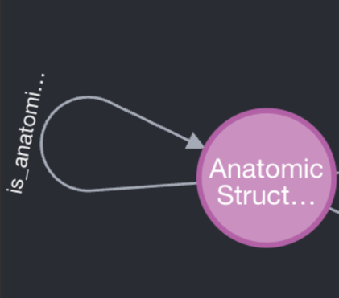

# UBKG-JKG: Self-referential edges

In the JKG, a _self-referential edge_ is an assertion for which the identifiers for the subject and object of the assertion 
have the same concept identifier. The JKG framework does not import self-referential edges from sources.

# Explanation

A source that is to be ingested into the JKG provides assertions in an 
_edge file_ in the [JKG Edge Node format](https://github.com/x-atlas-consortia/ubkg-jkg-generation#jkg-edgenode-jkgen-format).

Following is an example of assertions from the JKGEN edge file for the UBERON SAB.
```azure
subject	predicate	object
UBERON:0013152	located_in	UBERON:0002094
UBERON:0007759	part_of	UBERON:0003634
```
The JKG generation framework assigns concept identifiers to the subject and object nodes of an assertion
according to the JKG [equivalence algorithm](https://github.com/x-atlas-consortia/ubkg-jkg-generation/blob/main/docs/UBKG-JKG%20equivalence%20algorithm.md).

The resulting rel object in the JKG JSON includes the concept identifiers for the subject and object nodes in the edge file.
```azure
{"label": "located_in", "start": {"properties": {"id": "UBERON:0013152"}}, "end": {"properties": {"id": "UMLS:C0225870"}}, "properties": {"sab": "UBERON", "evidence_class": "", "evidence_calss": ""}}
```

If the subject and object nodes have the same concept identifier, the edge is considered self-referential.
If a rel in the JKG neo4j is built from a self-referential edge, the rel will start and end in the same Concept node.



# Sources of self-referential edges
## UMLS (MRREL.RRF)

The UMLS source files define relationships in the MRREL.RRF file.

MRREL.RRF contains a number of self-referential relationships. Following is an excerpt from the
MRREL.RRF showing that UMLS concept **C2885100** has a self-referential _has_expanded_form_ relationship.

```azure
CUI1,AUI1,STYPE1,REL,CUI2,AUI2,STYPE2,RELA,RUI,SRUI,SAB,SL,RG,DIR,SUPPRESS,CVF

C2885100|A18912708|AUI|SY|C2885100|A20131714|AUI|has_expanded_form|R132084559||ICD10CM|ICD10CM|||N||
```
It may be that a self-referential edge in MRREL.RRF corresponds to a merger of an obsolete CUI from a previous release of the UMLS.

## SABs
### patent self-referential edges
The JKGEN edge files of a number of SABs contain edges that are unambiguously self-referential. For example, following are 
examples of self-referential assertions:

#### UBERON
```azure
subject	predicate	object
UBERON:0001394	connecting_branch_of	UBERON:0001394
```

#### HSCLO
```azure
subject	predicate	object
HSCLO:chr6.170000001-170805979	above_100kbp_band	HSCLO:chr6.170800001-170805979	
```
### self-referential edges from cross-references

In a JKGEN node file, a SAB can cross-reference a node to a concept identifier via a cross-reference in the _node_dbxrefs_ column.
The equivalence algorithm may assign the concept identifier of the cross-reference to the node.

In some cases, both the subject and object nodes of a SAB's JKGEN edge file are assigned to the same
concept, resulting in a self-referential edge. This is because edges that are not "coderels" (CODE relationships)
are between Concept nodes, not identifiers for nodes.

For example, the UBERON edge file has edge
```azure
UBERON:0011860	composed_primarily_of	GO:0005581
```
The node file for UBERON contains a cross-reference to FMA:63212, which the UMLS links to the CUI C1179626. The 
JKG equivalence algorithm assigns UBERON:0011860 the CUI C1179626.

Because the UMLS also links GO:0005581 to UMLS:C1179626, both the subject and objects of the 
original edge map to the same concept, creating a self-referential edge.

# JKG ETL policies
The JKG framework excludes self-referential edges from import into the JKG.
This includes:
1. Self-referential edges in MRREL.RRF from the UMLS
2. Patent self-referential edges from edge files
3. Self-referential edge files that arise from concept cross-referencing